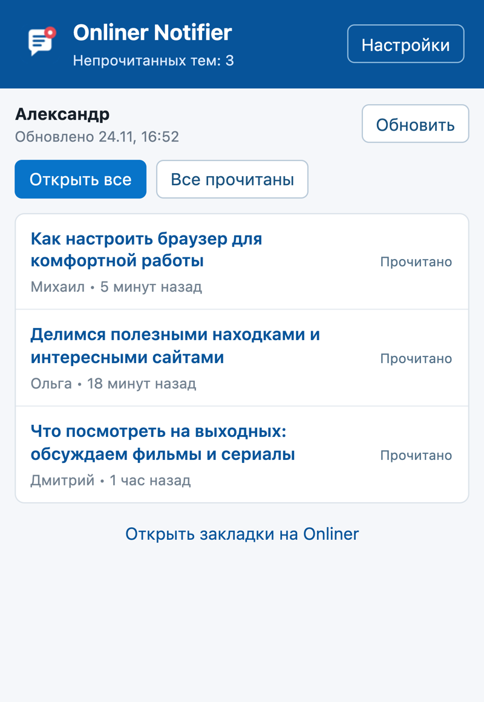

<div align="center">
  
  <h1>Onliner Notifier</h1>
  <p>Новые ответы в закладках форума Onliner — без лишних открытых вкладок.</p>

  <a href="https://github.com/satroschenko/onliner-notifier/actions/workflows/ci.yml"></a>
  <a href="https://github.com/satroschenko/onliner-notifier/releases"></a>
  <a href="LICENSE"></a>
</div>

## Что умеет

- показывает непрочитанные темы и их количество на иконке;
- отправляет уведомления и может воспроизводить звук;
- открывает одну тему или все сразу;
- отмечает темы прочитанными;
- проверяет закладки автоматически — по умолчанию раз в 10 минут;
- работает в Chrome, Edge, Firefox и Safari на macOS.

<div align="center">
  
</div>

## Установка

Готовые файлы находятся на странице [Releases](https://github.com/satroschenko/onliner-notifier/releases).

### Chrome или Edge

1. Скачайте `onliner-notifier-chrome.zip` и распакуйте архив.
2. Откройте `chrome://extensions` или `edge://extensions`.
3. Включите режим разработчика.
4. Нажмите «Загрузить распакованное расширение» и выберите распакованную папку.

### Firefox

1. Скачайте `onliner-notifier-firefox.xpi`.
2. Откройте `about:debugging#/runtime/this-firefox`.
3. Нажмите «Загрузить временное дополнение» и выберите скачанный файл.

Так Firefox установит расширение до следующего перезапуска. Для постоянной установки файл должен быть подписан Mozilla — публикация в каталоге дополнений планируется отдельно.

### Safari на macOS

1. Скачайте `onliner-notifier-safari-xcode.zip` и распакуйте его.
2. Откройте проект в Xcode и нажмите Run.
3. Включите Onliner Notifier в настройках Safari.
4. На странице настроек расширения разрешите уведомления кнопкой «Проверить уведомление».

В релизе также есть готовое приложение `onliner-notifier-safari-macos.zip`. Оно не подписано Apple, поэтому запуск через Xcode пока остаётся рекомендуемым вариантом.

## Вход в Onliner

Отдельный пароль расширению не нужен. Просто войдите в Onliner в том же браузере, где установлено расширение, и нажмите «Обновить» в его панели.

После установки первая проверка запоминает текущие непрочитанные темы. Уведомления приходят только о последующих изменениях.

## Приватность

Расширение работает без собственного сервера, рекламы и аналитики. Настройки и список тем хранятся в браузере. Запросы отправляются только на Onliner. Пароль расширение не запрашивает и не сохраняет.

Сейчас поддерживается только форум. Барахолка и автоматический UP объявлений сознательно оставлены на потом.

## Для разработки

```sh
npm ci
npm run build
```

Готовые сборки появятся в `dist/chrome`, `dist/firefox` и `dist/safari`. Команда `npm run check` проверяет типы и собирает все варианты.

## Лицензия

Проект распространяется по лицензии [MIT](LICENSE).
